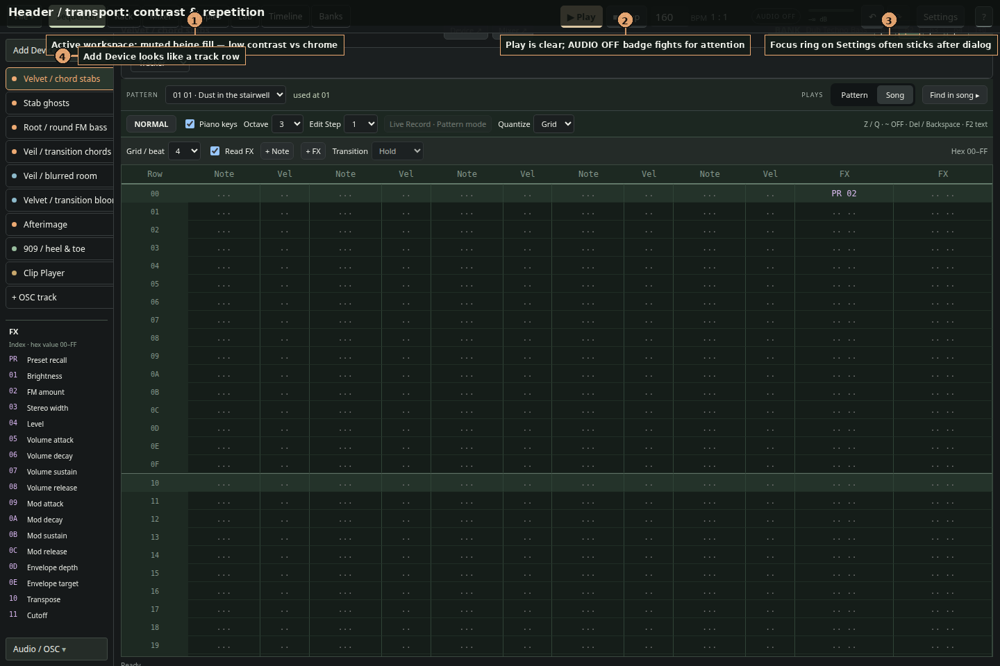
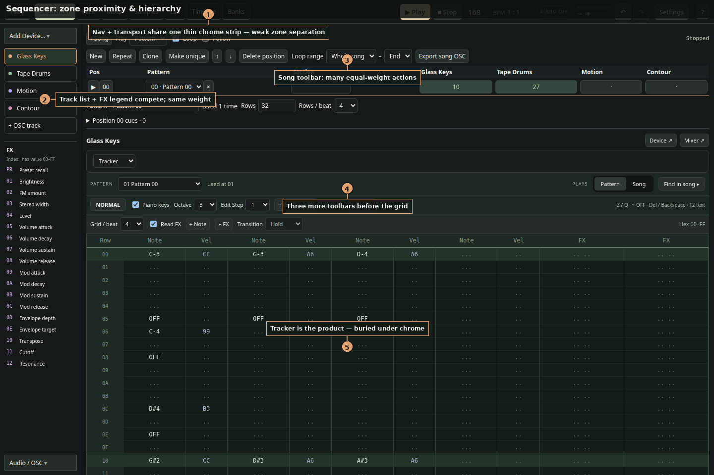
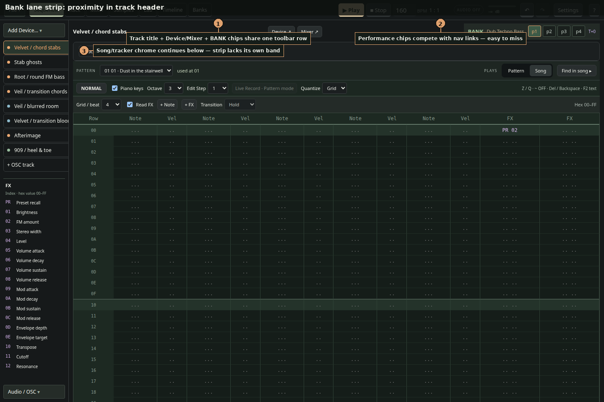
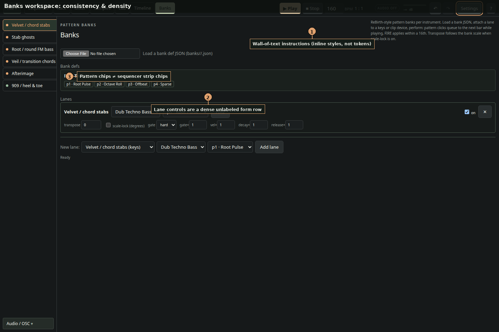
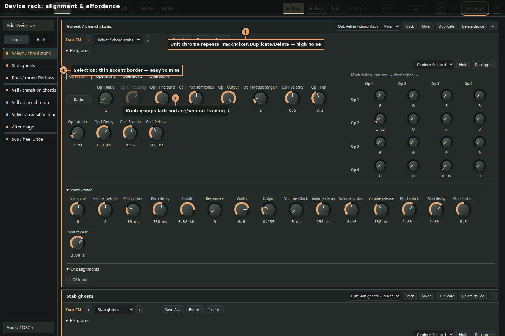
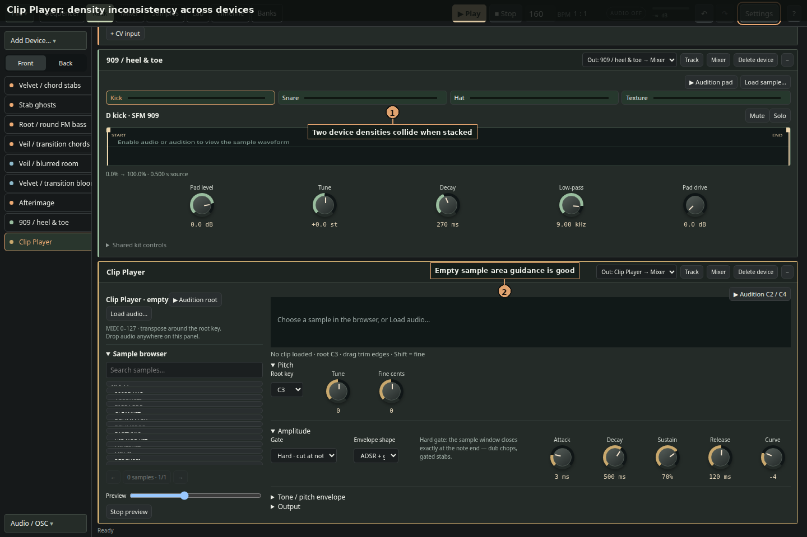
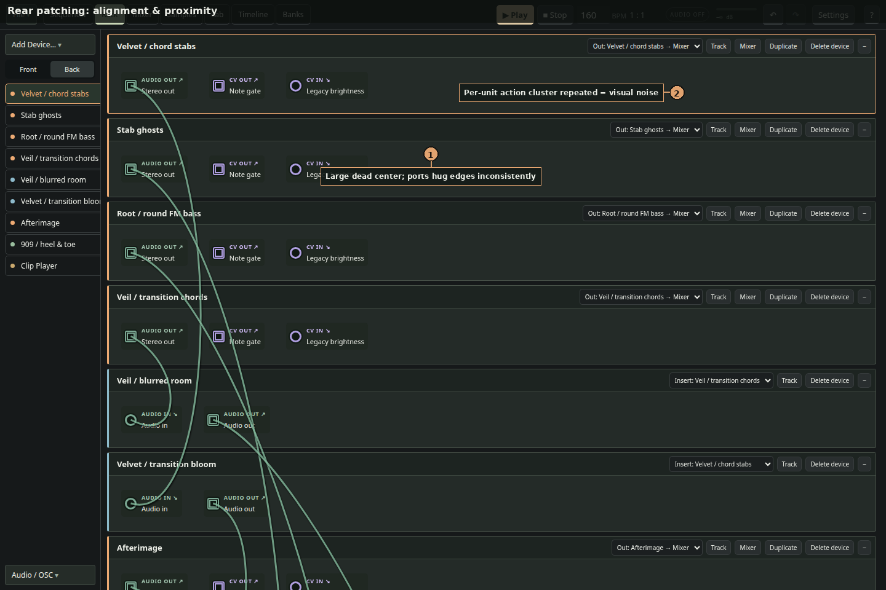
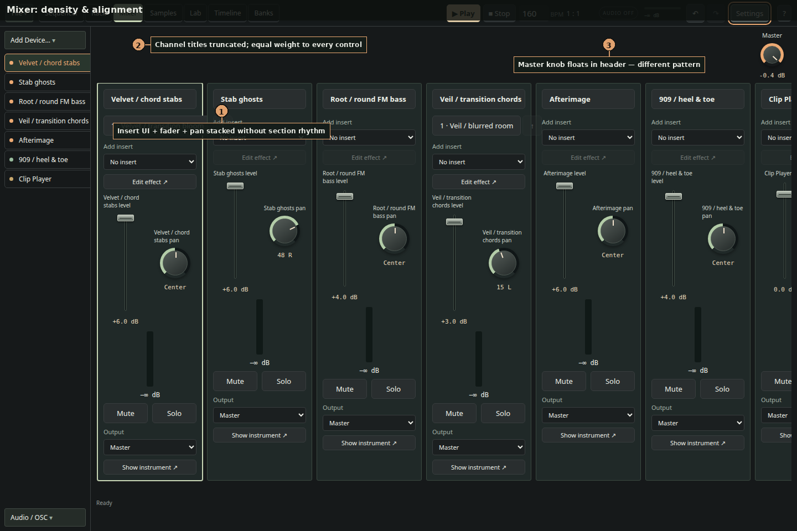

# Generant UX audit (current state)

**Scope:** Audit only — no redesign or refactor. Captured against `main` @ ~0.12.1 (web build via `npm run dev:web`, Chromium headless, Nov 2026).  
**Reference layout plan:** [`LAYOUT_PROPOSAL.md`](../LAYOUT_PROPOSAL.md) (commit `3e1fa23`, decisions D1–D5) — cited in §7; not implemented here.  
**Artifacts:** screenshots + annotated callouts in [`docs/ux-audit/`](./ux-audit/). Raw inventory: [`ux-audit/css-inventory.json`](./ux-audit/css-inventory.json).

**Method:** Booted the app, loaded Glass / Sideways Bloom / empty projects, walked Sequencer (tracker + song), Banks, bank lane strip, Rack (front + rear, Clip Player, Four FM, Drum Rack), Mixer, Samples, File menu, Settings, Help, and 1440 / 1100 / 900 viewports. Findings are grounded in those captures and in the actual CSS/JS surface styles.

**Core thesis (why it feels “leagues behind Reason”):** Generant already has the right *topology* (header transport, left browser, stacked rack, tracker+song). What fails is *visual grammar*: tool areas do not read as distinct zones; contrast and alignment are soft; spacing and radii are one-off values; chrome density crowds the musical surface. Reason’s polish is mostly proximity, contrast, alignment, and repetition applied ruthlessly — not more features.

---

## 1. Screenshot index

| # | File | Surface / state |
|---|------|-----------------|
| 01 | [`01-main-sequencer-default.png`](./ux-audit/01-main-sequencer-default.png) | Sequencer, Glass demo |
| 02 | [`02-rack-default-devices.png`](./ux-audit/02-rack-default-devices.png) | Rack, Glass devices |
| 03 | [`03-file-menu-open.png`](./ux-audit/03-file-menu-open.png) | File menu |
| 04 | [`04-settings-dialog.png`](./ux-audit/04-settings-dialog.png) | Hardware / Settings dialog |
| 05 | [`05-empty-rack.png`](./ux-audit/05-empty-rack.png) | Empty rack |
| 06 | [`06-empty-sequencer.png`](./ux-audit/06-empty-sequencer.png) | Empty sequencer |
| 07–09 | [`07`](./ux-audit/07-sequencer-sideways-bloom.png)–[`09`](./ux-audit/09-tracker-grid.png) | Sideways Bloom song + tracker |
| 10–10c | [`10`](./ux-audit/10-bank-lane-strip-sequencer.png), [`10b`](./ux-audit/10b-bank-strip-closeup.png), [`10c`](./ux-audit/10c-bank-strip-queued.png) | Bank lane strip (+ queued FIRE) |
| 11–12 | [`11`](./ux-audit/11-banks-workspace-filled.png), [`12`](./ux-audit/12-banks-workspace-empty.png) | Banks workspace |
| 13–15 | [`13`](./ux-audit/13-rack-many-devices.png)–[`15`](./ux-audit/15-synth-four-fm.png) | Full rack, Clip Player, Four FM |
| 16–17 | [`16`](./ux-audit/16-mixer.png), [`17`](./ux-audit/17-samples-workspace.png) | Mixer, Samples |
| 18–21 | [`18`](./ux-audit/18-add-device-menu.png)–[`21`](./ux-audit/21-header-transport-nav.png) | Add Device, rear, help, header |
| 22–26 | [`22`](./ux-audit/22-small-sequencer-1100.png)–[`26`](./ux-audit/26-narrow-rack-900.png) | Small / narrow windows |
| 27–28 | [`27`](./ux-audit/27-piano-roll.png), [`28`](./ux-audit/28-drum-rack.png) | Piano roll, Drum Rack |
| ann-* | [`ann-01`](./ux-audit/ann-01-sequencer-zones.png)…[`ann-10`](./ux-audit/ann-10-rack-rear.png) | Annotated callouts |

**Note:** Nav lists Lab / Timeline; those panel modules are not present in this checkout (`lab-panel.mjs` / `timeline-panel.mjs` imports fail without stubs). Booted with temporary stubs for capture only — not committed.

---

## 2. Findings by surface

Severity: **H** high / **M** medium / **L** low. Effort: **S** small / **M** medium / **L** large (relative; not calendar estimates).

### 2.1 Header + workspace nav + transport



| Principle | Finding | Sev | Effort |
|-----------|---------|-----|--------|
| **Proximity** | File, seven workspaces, transport, meter, undo, Settings, Help share one ~48px strip. Zones are not grouped with gaps or backgrounds — everything reads as one button soup. | H | S |
| **Contrast** | Active workspace uses `#c8d6b6` fill (good) *or* a thin accent underline depending on cascade era — both exist in CSS history. Inactive tabs are near-invisible against `#16191a`. | H | S |
| **Alignment** | Transport (`margin-left:auto`) and project actions wrap independently; at ≤1100px the strip reflows into a jagged second row. | M | M |
| **Repetition** | Three “menu” patterns: `<details class="utility-menu">`, plain `<button>`, and `#examplesMenu` nested inside File. | M | S |
| Hierarchy | Play (`.primary`) is clear; Settings often retains `:focus-visible` orange outline after dialog close, stealing hierarchy from transport. | M | S |
| Affordance | `AUDIO OFF` badge looks like a control; meter looks decorative. Undo glyphs `↶↷` are cryptic vs labeled actions. | M | S |
| Consistency | Workspace active style ≠ device-nav active style ≠ segmented Front/Back active style. | H | M |

### 2.2 Sequencer / tracker



| Principle | Finding | Sev | Effort |
|-----------|---------|-----|--------|
| **Proximity** | Vertical stack before notes: song toolbar → song matrix → track header → tracker context → entry tools → grid tools → grid. Song and pattern controls are not spatially “owned” by different bands. | H | M |
| **Contrast** | Tracker placeholders `...`, FX legend, and muted labels (`#929a97` / `#aab5ae` on `#151d19`) fail WCAG-ish contrast for dense reading. Playing row `#374835` is subtle. | H | S |
| **Alignment** | Song matrix column headers truncate and drift vs cell columns on filled projects (Sideways Bloom). Multiple toolbars use different padding (`5–8px`) and gap (`6–10px`) so edges never line up. | H | M |
| **Repetition** | Pattern vs Song appears in *both* song toolbar and tracker context — same decision, two places, two widget styles (checkbox/dropdown vs segmented). | H | M |
| Hierarchy | The musical grid — the product — is visually subordinate to chrome. | H | M |
| Density | Three tracker chrome rows at 11px; keyboard hint text competes with controls. | H | M |
| Affordance / feedback | Entry mode NORMAL/INSERT and Live Record feedback exist and are good; focus styles flip between outline and inset underline across CSS layers. | M | S |
| Keyboard / undo | Modal insert + Escape cancel are strong. Undo is present but not surfaced near destructive song actions (Delete position). | M | S |
| Forgiveness | “Delete position” sits in the same equal-weight row as New/Clone — high misclick cost. | H | S |

### 2.3 Song mode

Raw: [`08-song-mode-matrix.png`](./ux-audit/08-song-mode-matrix.png)

| Principle | Finding | Sev | Effort |
|-----------|---------|-----|--------|
| Proximity | Arrangement and pattern editor fight for the same viewport; neither gets a clear “home” band. | H | L (layout) |
| Contrast | Filled cells `#35483f` vs empty `.` are readable; sticky headers `#1b2022` blend into page. | M | S |
| Alignment | Track name headers wrap/truncate; numeric cells don’t share a column rhythm with long names. | M | M |
| Consistency | Song matrix inputs use different min-heights/paddings than tracker cells. | M | S |
| Interaction | Playing / queued row cues exist (`playing` / `queued` classes) — good feedback to preserve. | — | — |

### 2.4 Bank lane strip (sequencer track header)



| Principle | Finding | Sev | Effort |
|-----------|---------|-----|--------|
| **Proximity** | Strip is jammed into `.sequence-toolbar` with track title + Device/Mixer links (`margin-left:auto`). Performance chips compete with navigation chrome. | H | S–M |
| **Contrast** | Inactive chips `#1a201d` / `#4a5b4e` are barely distinct from the toolbar; active `#3d5a47` is subtle. FIRE accent is correct when queued. | M | S |
| Alignment | Single flex-wrap row; at mid widths chips wrap under Device/Mixer and look orphaned. | M | S |
| Consistency | Chip UI ≠ Banks workspace pattern pills (inline styles there). Two visual languages for the same patterns. | H | M |
| Affordance | Queue vs immediate vs FIRE is learnable once, but off-lane state only reports via toast (“Lane is off…”). | M | S |
| Hierarchy | `BANK` label + bank name use muted greens; easy to miss that this is the live performance surface. | M | S |

### 2.5 Banks workspace



| Principle | Finding | Sev | Effort |
|-----------|---------|-----|--------|
| Proximity | Def list, lane card, and “new lane” form are stacked with thin borders; lane modifiers are one unbroken horizontal form. | M | M |
| Contrast | Instruction paragraph is a low-contrast wall of text. | M | S |
| Alignment | Lane controls don’t share a column grid with “Add lane”. | M | S |
| Consistency | **Heavy inline `style=`** in `bank-panel.mjs` — bypasses `:root` tokens entirely (`#4a5b4e`, `#171b1a`, …). | H | M |
| Density | Transpose / scale-lock / gate / four multipliers at 10px — below comfortable click targets. | H | M |
| Empty state | Empty copy is OK ([`12`](./ux-audit/12-banks-workspace-empty.png)); still no example bank in-repo to load. | M | S |
| Forgiveness | FIRE is labeled; queue timing is explained in prose not UI. | L | S |

### 2.6 Device rack (front)



| Principle | Finding | Sev | Effort |
|-----------|---------|-----|--------|
| Proximity | Each unit bar packs name, routing select, Track, Mixer, Duplicate, Delete — action cluster is louder than the device panel. | H | S |
| Contrast | Selected unit only changes border to `--device`; easy to lose selection among stacked units. | M | S |
| Alignment | Workshop layouts vary (FM grid vs kit vs clip); knob baselines don’t share a horizontal system. | M | L |
| Repetition | Unit chrome is consistent (good); *internal* section framing is absent — parameters float on flat `#242b28`. | H | M |
| Density | Four FM + matrix is powerful but undifferentiated; Voice/filter disclosure helps. | M | M |
| Affordance | Knobs (drag + double-click exact) are a strength. Operator tabs look like action buttons. | M | S |

### 2.7 Clip Player + Drum Rack



| Principle | Finding | Sev | Effort |
|-----------|---------|-----|--------|
| Density | Empty Clip Player guidance is clear; filled Drum Rack vs Clip show very different information density when stacked. | M | M |
| Affordance | “Drop audio anywhere” + empty copy is forgiving. Waveform gated on audio enable is correct but looks broken if audio is off. | M | S |
| Consistency | Kit pad grid vs Clip browser vs FM operators each invent their own panel grammar. | H | L |

### 2.8 Rack rear (patching)



| Principle | Finding | Sev | Effort |
|-----------|---------|-----|--------|
| Alignment | Ports hug left/right with large empty centers; jack positions don’t form a vertical patch bay. | M | M |
| Contrast | Wires `#83b99c` / CV `#b6a2ed` are good; socket labels are tiny (`9px`). | M | S |
| Affordance | Pending jack → white fill is clear. Square vs round for out/in is a nice touch, under-explained. | L | S |
| Proximity | Same noisy unit action cluster as front view remains on rear — unrelated to patching. | M | S |

### 2.9 Mixer



| Principle | Finding | Sev | Effort |
|-----------|---------|-----|--------|
| Proximity | Insert chain, fader, pan, meter, mute/solo, output, “Show instrument” share one strip without section bands. | H | M |
| Alignment | Channel strips are consistent with each other (good); Master knob lives in header — different pattern. | M | S |
| Contrast | Selected strip uses `#c8d6b6` outline (same as nav active) — OK but overused accent. | L | S |
| Density | Insert UI + routing duplicates rack concerns; strips feel like mini-rack pages. | M | M |
| Affordance | Fader thumb is a short horizontal bar on a vertical track — readable once learned, weak metaphor. | M | M |

### 2.10 Menus, dialogs, empty states, small windows

| Surface | Finding | Sev | Effort |
|---------|---------|-----|--------|
| Empty rack [`ann-07`](./ux-audit/ann-07-empty-rack.png) | Empty canvas + “Ready”; primary CTA (Add Device) is only in the sidebar — no in-canvas empty state. | H | S |
| Empty sequencer | Tracker chrome remains; little guidance for “add a device / open example”. | M | S |
| File menu | Works; nested Open Example is OK; many peer items without grouping (project vs demo vs code). | M | S |
| Settings | Dialog contrast is better than main UI; focus outline on opener sticks. | M | S |
| ≤1100 / 900 [`ann-08`](./ux-audit/ann-08-small-window.png) | Song + tracker + toolbars collapse into illegibility; aside shrinks; bank strip wraps badly. | H | M |
| Lab / Timeline nav | Dead destinations without modules — trust hit. | H | S (hide or stub) |

### 2.11 Cross-cutting: interaction & forgiveness

| Topic | Finding | Sev | Effort |
|-------|---------|-----|--------|
| Knobs | Vertical drag + exact entry is solid; hit targets 35–55px vary by context. | L | S |
| Drag (roll / wires) | Piano roll and cables work; rear wiring lacks hover affordance until click. | M | M |
| Keyboard | Tracker modal editing is a differentiator — keep; surface cheatsheet with better contrast. | M | S |
| Undo | Global undo exists; destructive song/device actions lack confirm or undo hint nearby. | H | S |
| Error prevention | Invalid FX cells get `aria-invalid` styling — good. Bank load errors toast — good. | — | — |
| Recoverability | Escape cancels drafts; Stop cleans keyboard voices — good. Empty states don’t recover the user into a first sound. | M | S |

---

## 3. Current-state visual inventory (from CSS)

Source of truth: `public/style.css` (~88 dense lines) + inline styles in `bank-panel.mjs`. Full dump: [`ux-audit/css-inventory.json`](./ux-audit/css-inventory.json).

### 3.1 Declared tokens (`:root`)

| Token | Value | Role |
|-------|-------|------|
| `--bg` | `#16191a` | Page |
| `--panel` | `#222627` | Panels (underused) |
| `--line` | `#383d3e` | Borders |
| `--text` | `#eceee7` | Body |
| `--muted` | `#929a97` | Secondary |
| `--accent` | `#edaa73` | Accent / focus |
| `--cv` | `#b3a6ef` | CV |
| `--audio` | `#82b6aa` | Audio |

Runtime: `--device` (per-device accent), `--position` / `--angle` / `--mod-angle` (knobs).

### 3.2 What is actually used (inconsistency)

- **~224 unique hex colors** in `style.css` alone; most one-offs near the declared tokens (e.g. dozens of near-black greens `#1a201d`, `#151d19`, `#1d2421`, `#202723`…).
- **Font sizes observed:** `8, 9, 10, 11, 12, 13, 14, 15, 16, 17, 19, 20, 22, 24, 34` px — **15 steps**. Dominant: 10px (47), 11px (43), 12px (26).
- **Border radii:** `0, 2, 3, 4, 5, 6, 7, 12, 20, 50%` — utility era settled on **3px**, older panels still **7px / 12px**.
- **Spacing:** px values are continuous noise; top counts are 10, 12, 8, 4, 5, 3, 6, 7, 9 — no 4/8 scale.
- **Buttons:** default padding `8×13` overridden later to `6×9` / `7×10` / `4×7` / `3×8` by context.
- **Banks panel:** separate palette via inline styles (`#4a5b4e`, `#171b1a`, `#1a201d`).
- **Typography:** `13px system-ui…` body; tracker/code `ui-monospace`. No webfonts; system stack is fine for a tool, but size chaos hurts hierarchy.
- **Active/selection colors:** `#c8d6b6` (nav), `#edaa73` (accent/focus), `--device` (rack unit), `#e0c289` (mute/solo active) — four “selected” languages.

### 3.3 Proposed minimal design-token set (proposal only)

A smallest set that would let zones differentiate without a redesign:

**Spacing scale:** `2, 4, 8, 12, 16, 24, 32` (map today’s 3/5/6/7/9 → nearest).

**Surface tones (zones):**

| Token | Suggested | Use |
|-------|-----------|-----|
| `--surface-0` | `#121615` | App chrome / header |
| `--surface-1` | `#16191a` | Workspace canvas |
| `--surface-2` | `#1c2220` | Sidebars, toolbars |
| `--surface-3` | `#242b28` | Raised panels / rack units |
| `--surface-4` | `#2c342f` | Controls, inputs |
| `--hairline` | `#3a4540` | Dividers (one line color) |

**Type scale:** `11 / 12 / 13 / 15 / 18 / 22` — body 13, chrome 12, labels 11, workspace title 18.

**Radius:** `2` (grids), `4` (controls), `999` (only true pills like badges).

**State colors:**

| Token | Role |
|-------|------|
| `--accent` | Primary action / focus (keep warm `#edaa73`) |
| `--accent-soft` | Selected nav / strip highlight |
| `--danger` | Destructive (Delete position, Delete device) |
| `--audio` / `--cv` | Keep semantic patch colors |
| `--device` | Keep per-device identity |

**Zone rule (the important part):** Header = `--surface-0`; aside = `--surface-2`; sequencer toolbands = `--surface-2` with a single hairline; musical grid = `--surface-1` with higher text contrast; rack units = `--surface-3` with left accent only (mute the action cluster).

---

## 4. Top 10 quick wins

Prioritized by user-visible polish ÷ effort. Still audit-only recommendations — not implemented.

| # | Win | Why | Sev | Effort |
|---|-----|-----|-----|--------|
| 1 | **Zone backgrounds for header / aside / toolbands / grid** using 3–4 surface tones | Fixes “not forgiving to look at” via proximity + contrast without layout change | H | S |
| 2 | **One active/selection language** (nav, track, rack unit, mixer strip) | Repetition; kills four competing “selected” looks | H | S |
| 3 | **Collapse tracker chrome to one primary + one overflow row** | Hierarchy: put the grid closer to the eyes | H | M |
| 4 | **Danger styling + confirm/undo hint on Delete position / Delete device** | Forgiveness | H | S |
| 5 | **Empty rack / empty project in-canvas CTA** → Add Device / Open Example | Affordance | H | S |
| 6 | **Hide or stub Lab / Timeline** until modules ship | Trust / consistency | H | S |
| 7 | **Promote bank strip visual weight** (chip contrast + dedicated band height); stop sharing styles with Device/Mixer links | Performance surface must look performable | H | S |
| 8 | **Replace Banks inline styles with shared classes/tokens** | Consistency + unlocks theming | M | M |
| 9 | **Mute rack unit action cluster** (iconize or overflow menu; keep name + routing) | Proximity / noise vs Reason device headers | H | S |
| 10 | **Blur focus after Settings close; calm `:focus-visible`** so it doesn’t look like a permanent selection | Hierarchy bug seen in most captures | M | S |

Honorable mentions: raise muted text contrast one step; align song matrix columns; give mixer strips section separators (inserts / fader / IO).

---

## 5. How this bears on the split pattern/song + rack layout (D1–D5)

[`LAYOUT_PROPOSAL.md`](../LAYOUT_PROPOSAL.md) argues exclusive workspaces hide devices while sequencing — the ReBirth/Renoise gap. This audit agrees that **persistence** is necessary, but also shows that **a split or dock will fail if it only duplicates today’s chrome**.

Implications for the decision points:

| Decision | Audit implication |
|----------|-------------------|
| **D1 — Dock (A) vs split column (B)** | Either works *after* zone tokens exist. Today’s rack unit chrome is too noisy to park beside a tracker; Option A (selected-device dock) is safer until unit headers are quieted (quick win #9). Option B without a narrow rack variant will crush the tracker (already gasping at 1100px). |
| **D2 — Strip in dock vs sequencer** | Two bank surfaces already diverge visually (workspace vs strip). Prefer **one** strip; give it a dedicated band (not `margin-left:auto` on the track header). Dock is a natural home. |
| **D3 — Bottom dock vs right rail** | Bottom dock matches “sequencer is home” and avoids narrowing the tracker grid (alignment findings). Right rail needs a redesigned compact rack first. |
| **D4 — A2 knobs in dock** | Knob/panel density varies wildly by device (Clip vs FM). A2 needs a **compact control subset** or it recreates the hierarchy problem in miniature. |
| **D5 — Audition keyboard** | Helpful for forgiveness (empty/audio-off confusion); keep visually in the dock band, not another toolbar row on the tracker. |

**Bottom line:** Ship visual grammar (surfaces, one selection language, quieter unit chrome, one bank strip) *before* or *with* A1. Otherwise a persistent rack/dock will make the app feel more crowded, not more like Reason.

---

## 6. Capture notes (repro)

```bash
npm run dev:web   # http://127.0.0.1:4315
# Chromium/Playwright against that origin; load demoProject / sideways-bloom /
# newProject; changeWorkspace(...); inject banks.defs+lanes for strip shots.
```

Temporary `lab-panel` / `timeline-panel` stubs were required to boot (imports in `app.mjs`); removed before commit.
